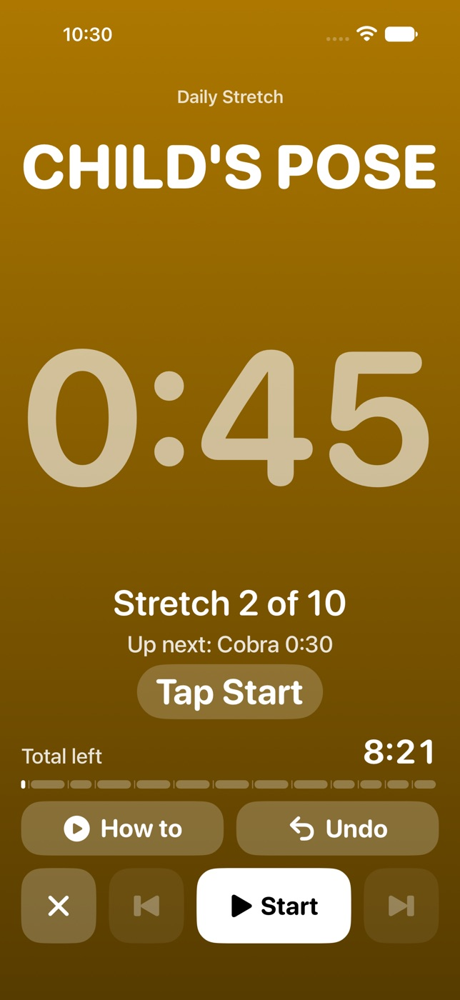
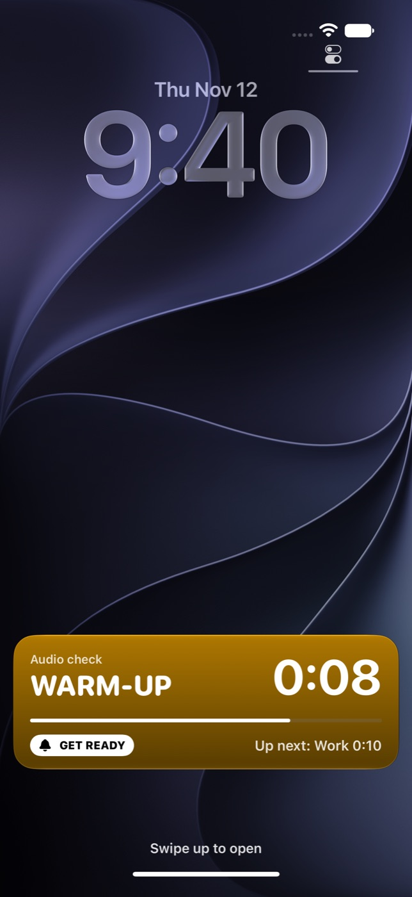
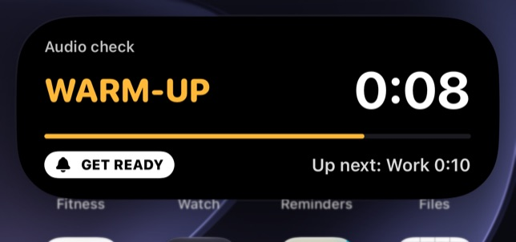
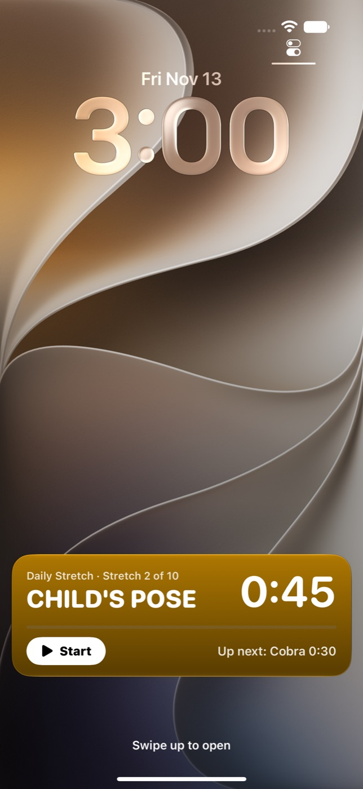

<p align="center">
  
</p>

<h1 align="center">Intervals</h1>

<p align="center">
  An interval and stretch timer for iPhone that keeps cueing with the screen locked.
</p>

<p align="center">
  <a href="https://github.com/Kron00/interval-tracker/releases/latest"></a>
  <a href="https://github.com/Kron00/interval-tracker/actions/workflows/ci.yml"></a>
  
  
</p>

<p align="center">
  
  
  
  
  
</p>

A workout timer for iPhone. It runs two kinds of workout from one library, and it can build either kind from a description that you type:

- An **interval timer** has a warm-up, work and rest rounds, and a cool-down.
- A **stretch routine** is a list of stretches. Each stretch is a timed hold or a number of reps, on one side or on each side, with an optional link to a how-to video.

An interval timer moves from phase to phase by itself. A stretch routine waits for you before every stretch. A timed hold starts when you tap **Start**, and a stretch counted in reps ends when you tap **Next**.

The app beeps, counts down, and speaks at each change. It keeps doing that with the screen locked, and it lowers your music for each cue without stopping it. Every screen is dark.

While you use other apps, the lock screen and the Dynamic Island show the phase and the time left. Before a rest ends, the app tells you to get ready.

Three presets are built in:

| Preset | What it is | Total |
| --- | --- | --- |
| Norwegian 4x4 | 5:00 warm-up, 4 × 4:00 work with 3:00 rest, 5:00 cool-down | 38:00 |
| 20/20 HIIT | 5:00 warm-up, 9 × 0:20 work with 0:20 rest, 3:00 cool-down | 14:00 |
| Daily Stretch | 10 stretches, 3 of them on each side, each with a video link | 8:21 + reps |

Reps are not timed. The total of a routine is its timed holds and their count-ins, and "+ reps" means that the reps come on top.

You cannot edit a preset. To change one, tap it, tap **Duplicate**, and edit the copy.

## Install the app with AltStore

AltStore installs the app without Xcode and tells you when a new version is out.

1. Install AltStore on the iPhone. [altstore.io](https://altstore.io) has the steps. They need a Mac or a PC.
2. In AltStore, open **Sources** and tap **+**.
3. Enter this address and add the source.

	```
	https://github.com/Kron00/interval-tracker/releases/latest/download/altstore.json
	```

4. Open the **Intervals** source and install **Intervals**.
5. If AltStore asks whether to keep the app's extensions, keep them. The extension draws the workout on the lock screen and in the Dynamic Island. Without it the app works and shows nothing there.

The app is named **Intervals** on the home screen.

With a free Apple Account the app stops opening after 7 days unless AltStore refreshes it. Your saved workouts stay on the phone.

## Install the app with Xcode

Use this path to run your own changes. You need a Mac with Xcode 27 or later, an Apple Account, and a cable. An iPhone on iOS 27 needs Xcode 27.

1. In Xcode, open **Settings**, then **Accounts**. Click **+** and sign in with your Apple Account.
2. Get the code and open the project.

	```sh
	git clone https://github.com/Kron00/interval-tracker.git
	open interval-tracker/IntervalTracker.xcodeproj
	```

3. In the project navigator, click **IntervalTracker**, then the **IntervalTracker** target, then **Signing & Capabilities**. Set **Team** to your name. Do the same for the **IntervalTrackerWidgets** target. If Xcode says the bundle identifier is not available, change `com.kron00.IntervalTracker` to an identifier of your own in both targets. The identifier of **IntervalTrackerWidgets** must start with the identifier of the app.
4. Connect the iPhone with the cable and unlock it. Tap **Trust** on the phone.
5. On the iPhone, open **Settings**, then **Privacy & Security**, then **Developer Mode**. Turn it on and restart the phone when asked.
6. In the Xcode toolbar, choose your iPhone as the run destination. Press Cmd-R.
7. If the phone refuses to open the app, open **Settings**, then **General**, then **VPN & Device Management** on the phone. Tap your developer certificate, then **Trust**.

With a free Apple Account the app stops opening after 7 days. Connect the phone and press Cmd-R again to renew it.

## Check the audio on your phone

Nobody has run this app on a real iPhone yet. The timer, the screens, and the sounds are tested in the simulator. Three behaviors exist only on a phone: whether the app stays awake while locked, whether your music dips and comes back, and whether the lock screen lights up for the heads-up. The app has a 1-minute check for all three.

1. Start your music.
2. In Intervals, tap the gear, then **Run 1-minute audio check**.
3. Lock the phone and listen.

| You hear | It means |
| --- | --- |
| "Get ready. Ten seconds." at 0:20, and the locked screen lights up with a card that reads **Get ready** | The heads-up and the Live Activity work. |
| "Get ready" is spoken and the screen stays dark | The Live Activity did not alert. In Intervals, open **Settings** and read the line under **Live Activity**. |
| Three beeps, a tone, and "Round one" at 0:27 | The app stays awake while locked. |
| Nothing after the first tone | iOS suspended the app. In Settings, open **Troubleshooting**, tap **Copy log**, and report it. |
| The music dips for each cue and returns to full between cues | Ducking works. Change nothing. |
| The music stays low after a cue | In **Troubleshooting**, choose **Dip, then restart audio** and run the check again. |
| The music never dips, or the cues are hard to hear | In **Troubleshooting**, choose **Low for the whole run**. |

If the run screen ever shows **No sound**, the app could not start its audio. It retries every second and the timer keeps counting.

## Run a workout

- Tap a workout, then **Start**.
- The forward button skips the current phase. The back button restarts it. From a hold, the back button goes to the count-in before the hold, so you have time to get back into position.
- **Undo** appears for 6 seconds after a skip, a **Start**, a **Next**, or a restart, also on the finish screen.
- **Pause** stops the clock. The screen turns grey and reads PAUSED. With headphone controls off, it also releases your music.
- **How to** appears for a stretch that has a link while a routine waits and while the workout is paused. It opens the link. No hold counts down in either state, so a video costs you no time.
- The X asks before it ends the workout. The question also says whether the workout will be saved to **History**.
- The finish screen shows the time you worked. Skipped time and paused time do not count. Restarted time counts twice.

### In a stretch routine, tap Start for every hold

Nothing in a stretch routine starts by itself.

- A timed hold waits first. The screen shows the stretch, the length of the hold, and a white **Start** button. Tap **Start**. A count-in of 3 seconds follows, with a beep each second, and then the hold counts down.
- When the hold reaches zero, the app sounds a tone, shows the next stretch, and says its name. That stretch waits for its own **Start**.
- A stretch on each side waits two times, once for the left side and once for the right side.
- A stretch counted in reps shows the number of reps and no clock. Do the reps at your own pace, then tap **Next**.

While the routine waits, the big white button is **Start** or **Next**, and the back and forward buttons are dimmed.

To leave a stretch early, tap the forward button during the count-in or the hold. The next stretch then waits.

The routine finishes by itself when the last hold reaches zero. If the last stretch is counted in reps, tap **Next** to finish.

The time you worked includes the count-ins and the time you spent on reps. It does not include the time the routine waited for **Start**.

## Look at your history

The app records every workout you finish. It also records a workout you end early, if you worked for at least 60 seconds. The audio check is never recorded.

When you tap the X during a workout, the question says which of the two will happen: "It will be saved to History as ended early." or "Under a minute of work, so it won't be saved to History."

To open **History**, tap the clock button at the top left of the library.

- The newest workout is first, and the workouts are grouped by day.
- The card at the top counts the workouts of this week and adds up the time you worked.
- Each entry shows the name of the workout, the time you worked, the time of day, and **Completed** or **Ended early**. If you worked less than the workout plans, the entry also shows the planned length.
- Tap an entry to see its details. **Start again** starts that workout as the library has it now.
- Swipe an entry left to delete it. **Clear all** deletes every entry after you confirm.

An entry keeps the name the workout had when you ran it. If you rename or delete the workout, the entry stays as it was. An entry whose workout you deleted has no **Start again** button.

The app keeps the newest 1000 entries. The history stays on the phone, in a file apart from your saved workouts.

## Build a stretch routine

1. Tap **+**, then **Stretch routine**.
2. Name the routine.
3. Tap **Add stretch**. Name the stretch, then choose **Hold** and a length, or **Reps** and a count.
4. To do the stretch on the left side and then the right side, turn on **Each side**.
5. To add a video, paste its address under **How-to link**.
6. Tap **Done**, add the other stretches, then tap **Save**.

Hold and drag a stretch to move it. Swipe a stretch left to delete it.

**Count-in after Start** is the time between **Start** and each hold. It is 3 seconds unless you change it. Choose **Off** to begin each hold the moment you tap **Start**. Reps have no count-in.

## Describe a workout and let ChatGPT build it

You can describe a workout in words. ChatGPT turns the description into an interval timer or a stretch routine, and you read it before you save it.

1. Tap **+**, then **Describe a workout**.
2. Tap **Continue with ChatGPT**. iOS asks whether Intervals may use a website to sign in. Tap **Continue** and sign in. The first time, ChatGPT asks whether Intervals may use your plan. Approve it.
3. Type what you want, for example "15-minute hip mobility routine". You can also tap one of the examples.
4. Tap **Generate**. To stop waiting, tap **Cancel**.
5. Read the result, then choose what to do with it.

| Button | What it does |
| --- | --- |
| **Save** | Adds the workout to **My workouts** and opens it, with **Start** on the screen |
| **Edit** | Opens the workout in the editor, where you can change it and save it. **Cancel** in the editor goes back to the result |
| **Try again** | Asks for another answer to the same description |
| **Reword** | Goes back to the description so that you can change it |

Nothing is saved until you tap **Save**. Only the text you type is sent to OpenAI.

**Try again** does not cost you the answer you have. A new answer replaces it only when the new answer arrives. If you tap **Cancel** while you wait, you are back at the answer you had. If the request fails, the app says why above that answer, and you can still save it.

An interval timer has one work length and one rest length. If you ask for rounds of different lengths, such as a pyramid, ChatGPT chooses one length and says so in a note above the total. A generated stretch routine works as one you build by hand does: each hold waits for **Start** and then counts in for 3 seconds. To change the count-in, tap **Edit**.

### Choose what pays for it

| Payment | How to set it up | What it costs |
| --- | --- | --- |
| Your ChatGPT plan | Tap **Continue with ChatGPT** in **Settings** or in **Describe a workout** | Each workout counts toward your plan's usage |
| An OpenAI API key | In **Settings**, paste the key under **OpenAI API key** and tap **Save key** | OpenAI bills the key for each request |

The plan pays when you are signed in and ChatGPT has allowed plan usage. Otherwise the key pays. With neither, the app asks you to sign in.

- To see or limit how much of your plan the app may use, tap **Manage usage** in **Settings**.
- To use another model, choose it under **Model** in **Settings**. The app starts with the smallest model your account lists.
- To sign out, tap **Sign out**. The app revokes its sign-in at OpenAI and deletes it from the phone. An API key stays until you tap **Remove key**.

The sign-in and the key are kept in the iPhone's Keychain. If you do not use the feature for 30 days, the sign-in lapses and you sign in again.

The first sign-in adds an app named Intervals to your ChatGPT account. OpenAI's documentation says that you can remove it in ChatGPT under **Settings**, **Security and login**, **Sign in with ChatGPT**.

### If the sign-in does not come back to the app

ChatGPT ends a sign-in by sending the browser to an address on the phone itself, `http://127.0.0.1`. The app listens at that address while you sign in. If the sign-in page stays open, or shows an error after you approve, use Safari:

1. Close the sign-in page.
2. In **Settings**, tap **Trouble signing in?**, then **Sign in with Safari**.
3. Sign in and approve in Safari.
4. If Safari shows "Signed in. Go back to Intervals.", go back to the app. You are signed in.
5. If Safari says that it cannot open the page, copy the whole address from Safari's address bar. It starts with `http://127.0.0.1`.
6. Go back to Intervals, paste the address under **Paste the address**, and tap **Finish sign-in**.

### What is not proven about ChatGPT

The tests use a stand-in for OpenAI inside the app. One test contacts OpenAI, and it runs only when asked for, because a person has to sign in.

That test ran on 12 November 2026 in the simulator with one ChatGPT account. The app's own code did every step:

- It signed in. OpenAI registered the app, sent the browser back to the listener inside the app, and granted every scope the app asks for, including plan usage.
- It read the plan's eight models and picked `gpt-6-luna`.
- It asked for a "15-minute hip mobility routine" and built a routine of eight stretches from the answer.
- It signed out.

Three things are still untested:

- Signing in on a real iPhone. The simulator shares the Mac's network, and a phone does not.
- Whether your plan may be used by other apps. One plan was checked, and OpenAI's pages disagree about which plans qualify.
- Whether an app that AltStore signed keeps the sign-in in the Keychain. The live test kept its tokens in memory.

`Scripts/chatgpt-probe.py` sends the same requests from a Mac, without the app or Xcode.

To check your own account, run it. It opens the sign-in page in your browser, prints the scope you were granted and the models your plan lists, asks for one routine with a JSON Schema, and revokes its sign-in. It leaves an app named "Intervals probe" in your ChatGPT account.

```sh
/usr/bin/python3 Scripts/chatgpt-probe.py
```

| The script prints | It means |
| --- | --- |
| A scope without `chatgpt.tokens.use.direct` | Plan usage was declined, or the plan does not qualify. Use an API key. |
| `subscription_sharing_unsupported_capability` | A plan request may not carry a schema. The app's second request covers that case. |
| A routine | Sign-in, plan usage, and the schema all work for your account. |

To check the fourth, sign in from the app on your phone. If the sign-in page does not close by itself, follow the Safari steps above and report it.

## See the workout while you use other apps

A rest is when you pick up the phone. So the workout stays in view after you leave the app.

<p align="center">
  
  
</p>

- The lock screen shows a card in the colour of the phase, with the phase, the time left, and what is up next.
- On an iPhone with a Dynamic Island, the island shows a ring and the time left. Touch and hold the island to see the whole card.

iOS draws the countdown, so it keeps ticking while the app does nothing.

| The workout | What the card shows |
| --- | --- |
| Counts down | The time left and a bar that fills |
| Is paused | **Paused** and the time left |
| Waits for **Start** | A **Start** button and the length of the hold. Nothing counts until you tap **Start**, on the card or in the app |
| Waits for **Next** | A **Next** button and the number of reps |
| Has finished | **Workout complete** and the time you worked, for two minutes |

In a stretch routine, the card follows each stretch through its wait, its count-in and its hold. During the count-in it reads "Get ready" beside the name of the workout.

While the routine waits, you do not have to open the app. Tap **Start** or **Next** on the card. The button does what the big white button in the app does, and **Undo** in the app takes it back. In the Dynamic Island, touch and hold the island to see the button. The card can take a few seconds to change after a tap, because iOS has to wake the app first. A second tap does no harm.

<p align="center">
  
</p>

The card goes away when you end the workout or tap **Done**.

The first time, iOS asks under the card whether to allow Live Activities from Intervals. Tap **Allow**, then **Always Allow**. If Live Activities are turned off for Intervals in the Settings app of the iPhone, the workout runs as before. **Settings** in Intervals then says that the Live Activity is off.

### Get ready before work

In an interval timer, the voice says "Get ready. Thirty seconds." 30 seconds before a warm-up or a rest ends and work begins. From then on the run screen and the card read **Get ready**. The card also alerts, which lights a locked screen and opens the Dynamic Island.

In **Settings**, **Get ready before work** sets the notice to **Off**, **10 s**, or **30 s**.

- A phase gets no notice if it is less than 15 seconds longer than the notice. With 30 seconds of notice, a rest of 0:45 gets one and a rest of 0:44 gets none.
- A rest that the cool-down or the finish follows gets none.
- A stretch routine gets none, because you start every stretch yourself. The count-in after **Start** is not a notice, and the card does not alert for it.
- With **Voice cues** off, nothing is spoken. The screen and the card still change.

### What is not proven about the Live Activity

The simulator draws the lock screen and the Dynamic Island, and the UI tests check both. They also tap **Start** and **Next** on the card. Five things need a real iPhone:

- Whether the alert lights the screen of a locked phone.
- Whether the card follows a whole workout on a locked phone. The app updates the card from the background, which works only while the audio keeps the app awake.
- Whether AltStore installs the extension that draws the card.
- Whether **Start** on the card of a locked phone is followed by the count-in beeps when headphone controls are off. The routine releases the audio while it waits, and iOS may have suspended the app by the time you tap.
- How soon the card changes after a tap. The simulator took 2 to 3 seconds.

The audio check covers the first two. See [Check the audio on your phone](#check-the-audio-on-your-phone).

## Control a workout from your headphones

Headphone controls are off until you turn them on. In **Settings**, turn on **Headphone controls**. The same switch is on the screen of every stretch routine, above **Start**.

| Press | What it does |
| --- | --- |
| One press | Pause or resume. While a stretch routine waits, one press is **Start** or **Next** |
| Two presses | Skip the current phase. In a stretch routine this leaves the stretch, and the next one waits. While the routine waits, two presses are **Start** or **Next** |
| Three presses | Restart the current phase. From a hold this goes back to the count-in. While a stretch routine waits, three presses do nothing |

The lock screen shows the current phase as Now Playing, with the same three controls. While a stretch routine waits, it reads "Waiting for Start" or "Waiting for Next". This is separate from the card in [See the workout while you use other apps](#see-the-workout-while-you-use-other-apps), which shows with headphone controls on or off.

iOS sends headphone presses only to an app that plays audio alone. So while headphone controls are on, music from other apps stops for the whole workout. With headphone controls off, your music keeps playing and dips for each cue.

A workout that is paused, or that waits for **Start** or **Next**, keeps its audio for 15 minutes so that a press can reach it on a locked phone. After 15 minutes it lets go, and you carry on in the app.

With headphone controls off, a routine that waits releases your music. **Start** and **Next** are then on the screen and on the card of the lock screen. iOS may suspend the app if you lock the phone during a wait, and it wakes the app when you tap the card.

While headphone controls are on, a phone call pauses the workout, and so does another app that starts to play.

### What is not proven about headphone controls

Nobody has pressed a headphone button with this app on a real iPhone. The simulator has no headphones, and no test looks for Now Playing on its lock screen. Three things are untested:

- Whether iOS shows the app on the lock screen when the app plays only silence between cues.
- Whether a press reaches the app while the workout is paused or waits for **Start** or **Next**, and the phone is locked.
- Whether the workout resumes by itself after a phone call ends.

Everything after the press is tested. To check the rest on your phone, follow **Headphone check** in **Settings**. If a press does nothing, open **Troubleshooting**, tap **Copy log**, and report it. The log has a line for every press that arrived.

## Run the tests

`Scripts/test-core.sh` runs the timer logic tests on any Mac, with or without Xcode.

The app tests and the UI tests need Xcode and a simulator:

```sh
xcodebuild test -project IntervalTracker.xcodeproj -scheme IntervalTracker \
	-destination 'platform=iOS Simulator,name=iPhone 16 Pro Max' CODE_SIGNING_ALLOWED=NO
```

The tests for the ChatGPT feature answer every request from a stand-in. One test contacts OpenAI, and it runs only when you ask for it.

CI runs both on every push, plus a build for the device architecture. The UI tests attach a screenshot of each screen, and CI uploads the screenshots as the `test-results` artifact. Three of the UI tests lock the simulator and read the Live Activity from the lock screen.

## Change the project

`project.yml` is the source of the Xcode project. After you add or remove a file outside Xcode, run `xcodegen generate` and commit the result.

The project has two products. `IntervalTracker` is the app. `IntervalTrackerWidgets` is the extension that draws the Live Activity, and the app carries it inside.

[About the design](docs/design.md) explains how the timer keeps time, how the cues are scheduled, how the two audio modes differ, how the workout gets onto the lock screen, and how the app signs in to ChatGPT.

## Release a version

Push the commit you want to release, then run `Scripts/release.sh` with the version and a line about what changed:

```sh
Scripts/release.sh 1.1 "Stretch routines and headphone controls"
```

The script builds the app from the pushed commit, creates the GitHub release, and updates the AltStore source. AltStore then offers the new version on every phone that has the source.
