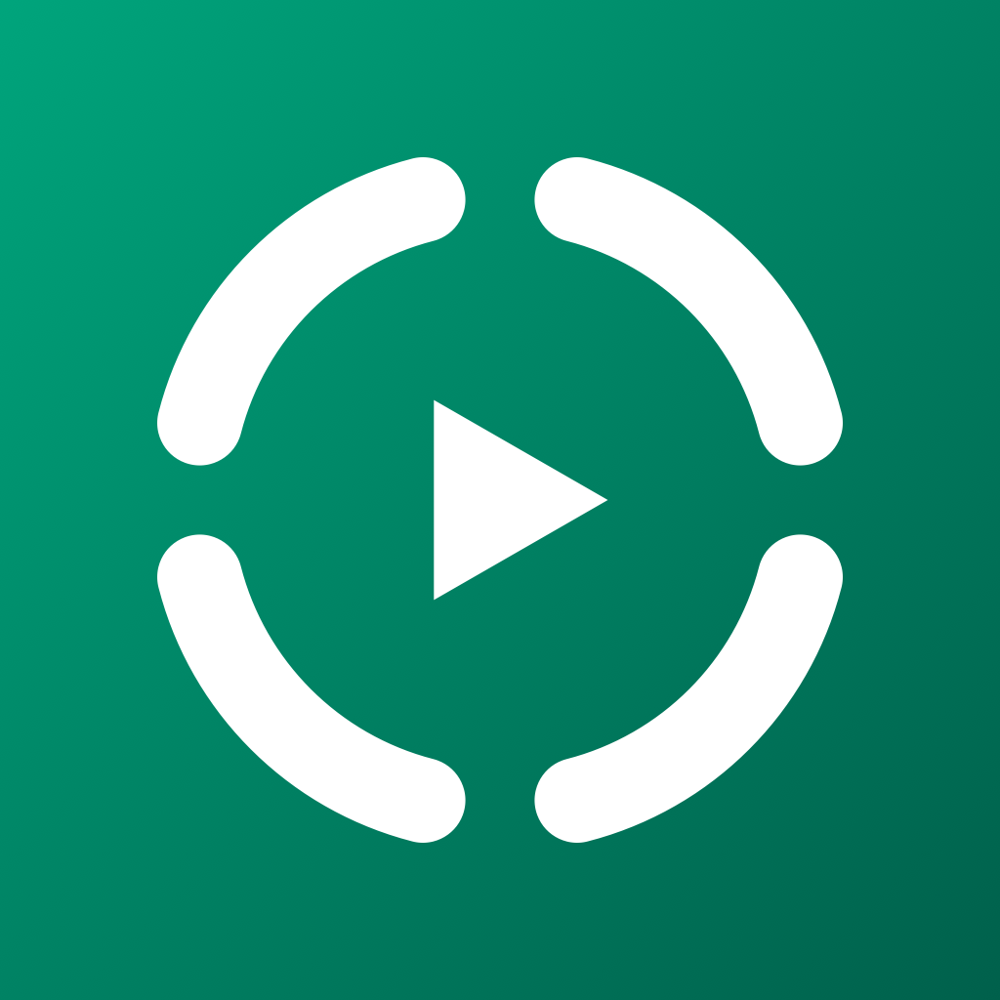
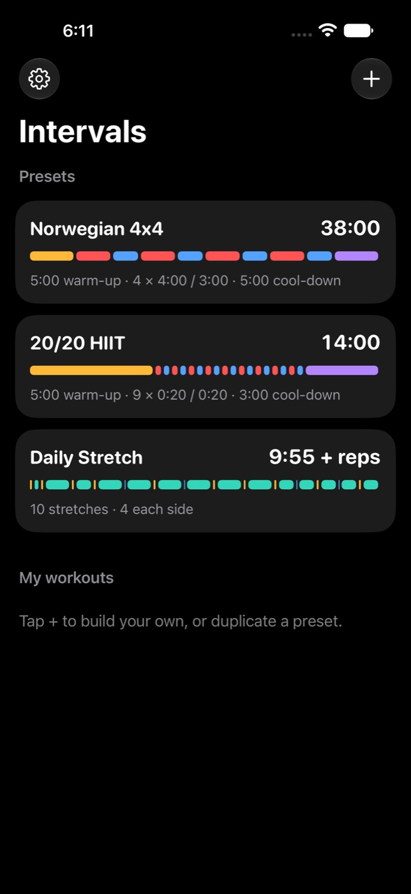
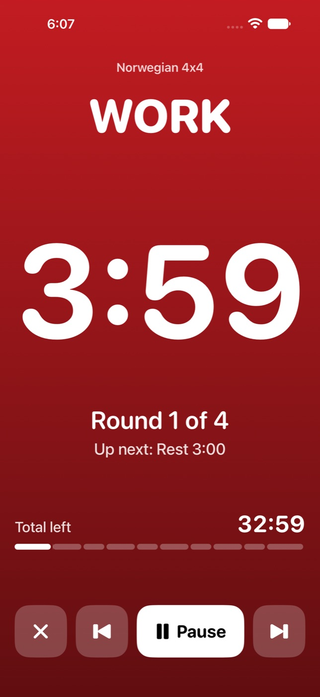
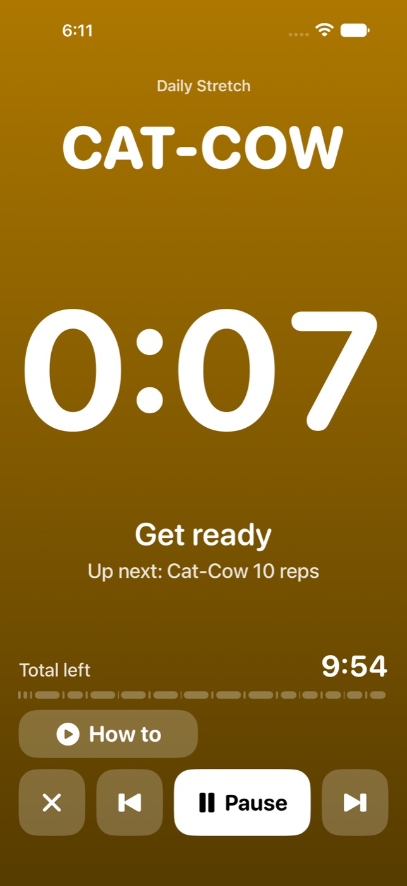
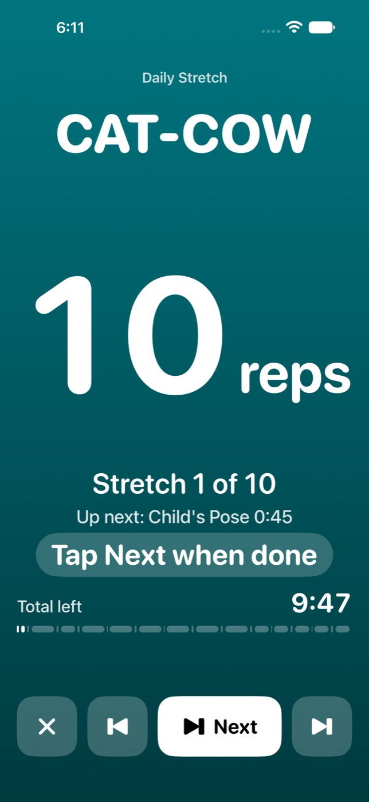
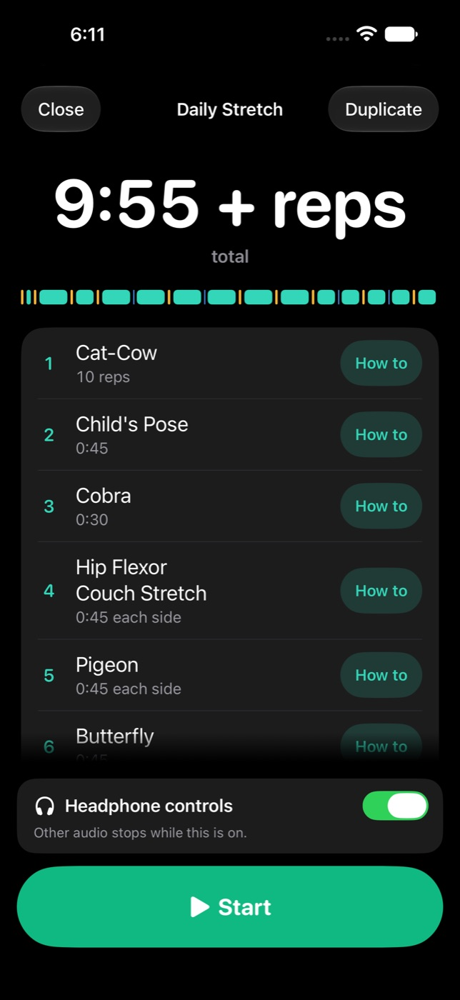

<p align="center">
  
</p>

<h1 align="center">Intervals</h1>

<p align="center">
  An interval and stretch timer for iPhone that keeps cueing with the screen locked.
</p>

<p align="center">
  <a href="https://github.com/Kron00/interval-tracker/releases/latest"></a>
  <a href="https://github.com/Kron00/interval-tracker/actions/workflows/ci.yml"></a>
  
  
</p>

<p align="center">
  
  
  
  
  
</p>

A workout timer for iPhone. It runs two kinds of workout from one library:

- An **interval timer** has a warm-up, work and rest rounds, and a cool-down.
- A **stretch routine** is a list of stretches. Each stretch is a timed hold or a number of reps, on one side or on each side, with an optional link to a how-to video.

An interval timer moves from phase to phase by itself. A stretch routine waits for you after every stretch, and goes on when you tap **Next**.

The app beeps, counts down, and speaks at each change. It keeps doing that with the screen locked, and it lowers your music for each cue without stopping it. Every screen is dark.

Three presets are built in:

| Preset | What it is | Total |
| --- | --- | --- |
| Norwegian 4x4 | 5:00 warm-up, 4 × 4:00 work with 3:00 rest, 5:00 cool-down | 38:00 |
| 20/20 HIIT | 5:00 warm-up, 9 × 0:20 work with 0:20 rest, 3:00 cool-down | 14:00 |
| Daily Stretch | 10 stretches, 4 of them on each side, each with a video link | 9:55 + reps |

Reps are not timed. The total of a routine is its timed holds and gaps, and "+ reps" means that the reps come on top.

You cannot edit a preset. To change one, tap it, tap **Duplicate**, and edit the copy.

## Install the app with AltStore

AltStore installs the app without Xcode and tells you when a new version is out.

1. Install AltStore on the iPhone. [altstore.io](https://altstore.io) has the steps. They need a Mac or a PC.
2. In AltStore, open **Sources** and tap **+**.
3. Enter this address and add the source.

	```
	https://github.com/Kron00/interval-tracker/releases/latest/download/altstore.json
	```

4. Open the **Intervals** source and install **Intervals**.

The app is named **Intervals** on the home screen.

With a free Apple Account the app stops opening after 7 days unless AltStore refreshes it. Your saved workouts stay on the phone.

## Install the app with Xcode

Use this path to run your own changes. You need a Mac with Xcode 27 or later, an Apple Account, and a cable. An iPhone on iOS 27 needs Xcode 27.

1. In Xcode, open **Settings**, then **Accounts**. Click **+** and sign in with your Apple Account.
2. Get the code and open the project.

	```sh
	git clone https://github.com/Kron00/interval-tracker.git
	open interval-tracker/IntervalTracker.xcodeproj
	```

3. In the project navigator, click **IntervalTracker**, then the **IntervalTracker** target, then **Signing & Capabilities**. Set **Team** to your name. If Xcode says the bundle identifier is not available, change `com.kron00.IntervalTracker` to any identifier of your own.
4. Connect the iPhone with the cable and unlock it. Tap **Trust** on the phone.
5. On the iPhone, open **Settings**, then **Privacy & Security**, then **Developer Mode**. Turn it on and restart the phone when asked.
6. In the Xcode toolbar, choose your iPhone as the run destination. Press Cmd-R.
7. If the phone refuses to open the app, open **Settings**, then **General**, then **VPN & Device Management** on the phone. Tap your developer certificate, then **Trust**.

With a free Apple Account the app stops opening after 7 days. Connect the phone and press Cmd-R again to renew it.

## Check the audio on your phone

Nobody has run this app on a real iPhone yet. The timer, the screens, and the sounds are tested in the simulator. Two behaviors exist only on a phone: whether the app stays awake while locked, and whether your music dips and comes back. The app has a 1-minute check for both.

1. Start your music.
2. In Intervals, tap the gear, then **Run 1-minute audio check**.
3. Lock the phone and listen.

| You hear | It means |
| --- | --- |
| Three beeps, a tone, and "Round one" at 0:27 | The app stays awake while locked. |
| Nothing after the first tone | iOS suspended the app. In Settings, open **Troubleshooting**, tap **Copy log**, and report it. |
| The music dips for each cue and returns to full between cues | Ducking works. Change nothing. |
| The music stays low after a cue | In **Troubleshooting**, choose **Dip, then restart audio** and run the check again. |
| The music never dips, or the cues are hard to hear | In **Troubleshooting**, choose **Low for the whole run**. |

If the run screen ever shows **No sound**, the app could not start its audio. It retries every second and the timer keeps counting.

## Run a workout

- Tap a workout, then **Start**.
- The forward button skips the current phase. The back button restarts it. From a stretch, the back button goes to the get-ready gap before the stretch, so the app names the stretch again.
- **Undo** appears for 6 seconds after a skip, a **Next**, or a restart, also on the finish screen.
- **Pause** stops the clock. The screen turns grey and reads PAUSED. With headphone controls off, it also releases your music.
- **How to** appears while you get ready for a stretch that has a link. It pauses the workout and opens the link.
- The X asks before it ends the workout.
- The finish screen shows the time you worked. Skipped time and paused time do not count. Restarted time counts twice.

### In a stretch routine, tap Next after every stretch

Nothing in a stretch routine moves on by itself.

- A timed hold counts down and beeps at zero. The screen then reads **Done** and the routine waits.
- A stretch counted in reps shows the number of reps and no clock. Do the reps at your own pace. The routine waits from the start.
- A stretch on each side waits two times, after the left side and after the right side.

While the routine waits, the big white button is **Next**. Tap it, or tap the forward button, which does the same. The get-ready gap of the next stretch then runs by itself, and the hold starts by itself. That is one tap for each stretch.

To end a hold early, tap the forward button while the hold counts down.

The routine finishes by itself when a timed hold in last place runs out. If the last stretch is counted in reps, the routine finishes when you tap **Next**.

The time you worked includes the time you spent on reps. It does not include the time the routine waited after a timed hold.

## Build a stretch routine

1. Tap **+**, then **Stretch routine**.
2. Name the routine.
3. Tap **Add stretch**. Name the stretch, then choose **Hold** and a length, or **Reps** and a count.
4. To do the stretch on the left side and then the right side, turn on **Each side**.
5. To add a video, paste its address under **How-to link**.
6. Tap **Done**, add the other stretches, then tap **Save**.

Hold and drag a stretch to move it. Swipe a stretch left to delete it.

**Get ready** is the gap before every stretch. The voice names the stretch in that gap, so the gap must be 0:05 or longer. **Switch sides** is the gap between the left side and the right side.

## Control a workout from your headphones

Headphone controls are off until you turn them on. In **Settings**, turn on **Headphone controls**. The same switch is on the screen of every stretch routine, above **Start**.

| Press | What it does |
| --- | --- |
| One press | Pause or resume |
| Two presses | Skip the current phase. In a stretch routine this is **Next** |
| Three presses | Restart the current phase |

The lock screen shows the current phase with the same three controls. While a stretch routine waits, it reads "Waiting for Next".

iOS sends headphone presses only to an app that plays audio alone. So while headphone controls are on, music from other apps stops for the whole workout. With headphone controls off, your music keeps playing and dips for each cue.

A workout that is paused, or that waits for **Next**, keeps its audio for 15 minutes so that a press can reach it on a locked phone. After 15 minutes it lets go, and you carry on in the app.

With headphone controls off, a routine that waits releases your music, and **Next** is only on the screen. iOS may suspend the app if you lock the phone during a wait.

While headphone controls are on, a phone call pauses the workout, and so does another app that starts to play.

### What is not proven about headphone controls

Nobody has pressed a headphone button with this app on a real iPhone. The simulator has no headphones and no lock screen. Three things are untested:

- Whether iOS shows the app on the lock screen when the app plays only silence between cues.
- Whether a press reaches the app while the workout is paused or waits for **Next**, and the phone is locked.
- Whether the workout resumes by itself after a phone call ends.

Everything after the press is tested. To check the rest on your phone, follow **Headphone check** in **Settings**. If a press does nothing, open **Troubleshooting**, tap **Copy log**, and report it. The log has a line for every press that arrived.

## Run the tests

`Scripts/test-core.sh` runs the timer logic tests on any Mac, with or without Xcode.

The app tests and the UI tests need Xcode and a simulator:

```sh
xcodebuild test -project IntervalTracker.xcodeproj -scheme IntervalTracker \
	-destination 'platform=iOS Simulator,name=iPhone 16 Pro Max' CODE_SIGNING_ALLOWED=NO
```

CI runs both on every push, plus a build for the device architecture. The UI tests attach a screenshot of each screen, and CI uploads the screenshots as the `test-results` artifact.

## Change the project

`project.yml` is the source of the Xcode project. After you add or remove a file outside Xcode, run `xcodegen generate` and commit the result.

[About the design](docs/design.md) explains how the timer keeps time, how the cues are scheduled, and how the two audio modes differ.

## Release a version

Push the commit you want to release, then run `Scripts/release.sh` with the version and a line about what changed:

```sh
Scripts/release.sh 1.1 "Stretch routines and headphone controls"
```

The script builds the app from the pushed commit, creates the GitHub release, and updates the AltStore source. AltStore then offers the new version on every phone that has the source.
